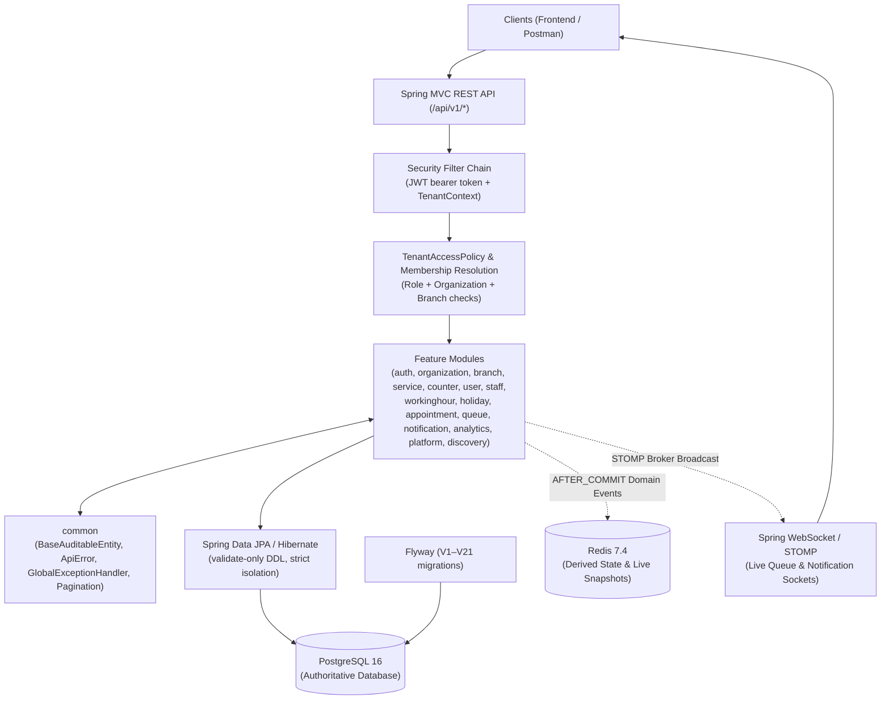

# SmartQueue Backend — Architecture Audit & Interview Readiness Guide

> **Phase 5A Deliverable** — Comprehensive, evidence-based architecture audit and interview preparation guide for the SmartQueue backend (Spring Boot 4.1.1, Java 21, PostgreSQL 16, Redis 7.4).
> **Scope:** Analysis, documentation, and interview readiness only. No application code, frontend code, migrations, configuration, or existing documentation was modified.

---

## 1. Executive Summary

SmartQueue is a production-quality, enterprise-grade backend for queue management and appointment booking. Built as a modular monolith in Java 21 and Spring Boot 4.1.1, it demonstrates rigorous concurrent safety (race-proof appointment booking, atomic `FOR UPDATE SKIP LOCKED` queue claims), strict multi-tenant isolation across organizations and branches, platform-level customer identity with membership-grounded operational roles, real-time WebSocket/STOMP queue projections over Redis, event-driven architecture with `AFTER_COMMIT` transaction boundaries, and robust transactional integrity backed by Flyway migrations and PostgreSQL.

This audit evaluates the codebase against production standards, documents its architectural decisions, maps its data flows and concurrency mechanisms, reviews its security and tenant isolation guarantees, and compiles a comprehensive interview readiness package.

---

## 2. Architecture Map & System Overview

SmartQueue adopts a **modular monolith** architecture using a **package-by-feature** structure (`com.sourabh.smartqueue`). PostgreSQL 16 is the authoritative source of truth, while Redis 7.4 holds ephemeral derived state (live queue snapshots and wait-time cache).

---

## 3. Module and Layer Responsibilities

SmartQueue strictly adheres to clean architectural layering within each feature module:

1. **Controllers (`*/api/`):** Thin HTTP entry points. Responsible for binding request parameters, triggering Jakarta Bean Validation (`@Valid`), delegating to application services, and returning immutable record DTOs or standard envelope responses. Controllers contain zero business logic.
2. **Application Services (`*/application/`):** Orchestrate business use cases within `@Transactional` boundaries. Enforce tenancy, coordinate domain services, publish immutable domain events (`applicationEventPublisher.publishEvent`), and manage persistence interactions.
3. **Domain / Business Logic:** Pure business rules, state transition guards, and invariants (e.g., appointment overlap rules, queue aging computations, wait-time estimation).
4. **Repositories (`*_repository.java`):** Spring Data JPA repositories scoped to organization/branch boundaries, utilizing derived queries and native SQL query fragments for advanced locking and window functions.
5. **Infrastructure (`infrastructure/`, `tenant/`, `common/`):** Cross-cutting technical concerns including JWT encoding/decoding (`JwtService`), fail-closed tenant thread-locals (`TenantContextHolder`), Redis JSON codecs, global exception handling (`GlobalRestExceptionHandler`), and STOMP security interceptors.

---

## 4. Real Request & Workflow Traces

### Workflow 1: Customer Registration & Email Verification
1. **Endpoint:** `POST /api/v1/auth/register` (`RegistrationController.java`)
2. **Validation:** Checks request body against DTO rules (`RegistrationRequest.java`: email uniqueness, password strength policy 8–72 chars with letter & digit).
3. **Service Execution:** `RegistrationService.registerCustomer` creates a platform-level `User` (`organization_id = NULL`, role `CUSTOMER`) and a hashed `UserCredential` (`V9`). Issues a 256-bit random verification token (storing SHA-256 digest, `V15`).
4. **Event / Notification:** After database commit (`@TransactionalEventListener(phase = TransactionPhase.AFTER_COMMIT)`), `AccountEmailListener` invokes the `EmailSender` port (`SmtpEmailSender` or log fallback) to dispatch an email via Mailpit.
5. **Verification:** `POST /api/v1/auth/verify-email` consumes the token, updates verification status, and unlocks login.

### Workflow 2: Appointment Availability & Booking
1. **Endpoint:** `POST /api/v1/branches/{branchId}/appointments` (`BranchAppointmentsController.java`)
2. **Security & Validation:** Authenticated customer; Spring Security validates JWT principal; path branch ID is validated against active organization status.
3. **Service Execution:** `AppointmentService` delegates to `AppointmentBookingService`.
   - Checks branch working hours (`WorkingHourRepository`) and holidays (`HolidayRepository`).
   - Computes available slots (`AppointmentAvailabilityService`).
   - Validates that the requested interval `[start, end)` does not overlap existing scheduled appointments.
4. **Concurrency & Persistence:** Saves `Appointment` entity (`V6`). Partial exclusion constraints in PostgreSQL prevent concurrent double-booking: exactly one transaction succeeds; concurrent inserts serialize on exclusion indexes.
5. **Event:** Publishes `AppointmentBookedEvent` on commit.

### Workflow 3: Queue Joining & Queue Advancement
1. **Endpoint:** `POST /api/v1/branches/{branchId}/queues/{queueId}/entries` (`QueueEntryController.java`)
2. **Execution:** `QueueService` delegates to `QueueJoinService`.
   - Validates service and branch state.
   - Allocates a daily token number atomically from the counter/token table.
   - Persists `QueueEntry` with status `WAITING` (`V7`).
3. **Staff Claim (Call Next):** `POST /api/v1/counters/{counterId}/call-next` (`CallNextController.java`) executes an atomic `FOR UPDATE SKIP LOCKED` query across capable queues (`QueueRankingSql.java`), aging entries according to `QueueAgingProperties`, and transitions the claimed entry to `CALLED`.
4. **Realtime Projection:** Publishes domain event, triggering `QueueRealtimeEventBridge` to rebuild the Redis snapshot and broadcast to STOMP topic `/topic/organizations/{o}/branches/{b}/queues/{q}`.

### Workflow 4: Organization Registration & Platform Approval
1. **Endpoint:** `POST /api/v1/auth/register/business` (`RegistrationController.java`)
2. **Execution:** Creates application atomically: `PENDING_APPROVAL` organization, initial branch, owner user (`ADMIN`), and an **`INACTIVE`** owner membership (`V21`).
3. **Platform Review:** Platform admin invokes `POST /api/v1/platform/organizations/{id}/approve` (`PlatformOrganizationController.java`).
4. **Activation:** Atomically transitions organization status to `ACTIVE` and activates the owner's `OrganizationMembership`.

### Workflow 5: Live Queue Wait-Time Updates
1. **Trigger:** Scheduled freshness tick (`QueueFreshnessService`, interval `queue.realtime.refresh.interval`, default 1 minute) or `AFTER_COMMIT` queue event.
2. **Execution:** `QueueRealtimeProjectionService` queries active queues, computes ranked positions and wait times via `QueueWaitTimeEstimator` (`floor(P / C) × S`), serializes snapshot, and executes a Redis compare-and-set store. If content changed materially, broadcasts over WebSocket STOMP.

---

## 5. Major Architectural Decisions & Trade-Offs

| Decision | Problem Solved | Implemented Approach | Trade-Offs & Alternatives | Evidence / ADR |
|---|---|---|---|---|
| **Modular Monolith** | Avoid distributed system complexity while maintaining clear feature separation. | Single deployable Spring Boot app with strict package-by-feature boundaries. | Easier transactions & consistency vs. independent scaling. Alternative: Microservices (rejected per AGENTS.md). | ADR-001, `system-architecture.md` |
| **PostgreSQL & Flyway** | Reliable schema evolution and strong ACID relational guarantees. | Flyway migrations (`V1–V21`), Hibernate `ddl-auto: validate`. | Migration discipline required vs. runtime schema drift. | ADR-003, ADR-004 |
| **Logical Multi-Tenancy** | Supporting multiple organizations securely in one DB instance. | Shared PostgreSQL DB with hierarchical FKs (Org → Branch → Res) and application-layer tenant context enforcement. | Requires rigorous service-level filtering vs. physical DB separation. | ADR-019, `TenantContextHolder.java` |
| **Platform Customers vs. Org Membership** | Allowing customers to book across multiple organizations without being locked into one. | Customers are platform-level identities (`organization_id = NULL`); operational staff/managers are bound via `OrganizationMembership`. | Slightly more complex authorization logic vs. strict single-tenant accounts. | ADR-040, `OrganizationMembership.java` |
| **Spring Security & JWT** | Stateless, secure authentication and authorization. | BCrypt credentials + HS256 JWTs (1h TTL, no refresh tokens) + TenantAccessPolicy. | Users must re-authenticate after token expiration vs. token revocation complexity. | ADR-021, `AuthService.java` |
| **Queue Concurrency (`SKIP LOCKED`)** | Preventing staff from claiming the same customer or starving normal entries. | Native `FOR UPDATE SKIP LOCKED` combined with capped aging (ADR-014). | PostgreSQL-specific SQL syntax vs. portable but lock-heavy queries. | ADR-012, ADR-014, `QueueRankingSql.java` |
| **Redis for Derived State** | Fast read access for real-time queue snapshots and wait times without hitting DB. | Redis 7.4 holding rebuilt JSON snapshots with 5-min TTL and CAS writes. | Ephemeral cache invalidation required on failure. Alternative: Read from DB directly. | ADR-017, ADR-020, `QueueRealtimeProjectionService.java` |

---

## 6. Security & Tenant-Isolation Assessment

### Verified Controls
- **Password Security:** Stored as BCrypt hashes in `user_credential` (V9), separate from user profiles; never logged or returned in DTOs (`UserResponse.java`).
- **JWT & Authentication:** HS256 JWTs signed with environment-supplied `JWT_SECRET` (min 32 bytes enforced at startup); claims validate user ID, email, and roles.
- **Fail-Closed Platform Admin:** `APP_PLATFORM_ADMIN_EMAILS` bootstrap requires explicit configuration, email verification, and valid login; empty configuration denies all review access (`PlatformOrganizationController.java`).
- **Object-Level & Tenant Authorization:** `TenantAccessPolicy` enforces that operational users belong to an active membership in the target organization. Customer reads are strictly owner-scoped (`customer = principal`). Foreign IDs return scope-safe `404 NOT_FOUND` rather than `403 FORBIDDEN` to prevent resource enumeration.
- **WebSocket Security:** Handshakes require `?token=<jwt>` query parameter; STOMP channel interceptor restricts subscriptions to authorized organization/branch/queue topics.

### Unverified / Limitations
- **Token Revocation:** JWTs are stateless with a 1-hour expiration; immediate revocation relies on password change tracking (`password_changed_at` in V14) rather than a distributed token blacklist.
- **Penetration Testing:** No formal third-party penetration testing or vulnerability scanning has been performed.

---

## 7. Database Design & Concurrency Assessment

- **Schema Evolution:** 21 Flyway migrations (`V1__...` to `V21__...`) manage schema creation, constraints, and performance indexes (`idx_appointment_status_start`, `idx_notification_created_at`, V13 analytics indexes).
- **Concurrency Protection:**
  - **Appointments:** Protected by database partial exclusion constraints (`EXCLUDE USING gist`) and `@Transactional` service boundaries, preventing overlapping bookings.
  - **Queues:** Protected by `FOR UPDATE SKIP LOCKED` row-level locks, ensuring atomic staff claims without deadlocks or duplicate assignments.
  - **Service Sessions:** Protected by `UNIQUE(queue_entry_id)` and row-locked state transitions.

---

## 8. Testing & Operational Readiness

- **Test Suite:** 795+ tests with 0 failures, covering unit tests, service integration tests, controller black-box tests, security/tenant-denial tests, concurrency race tests, and infrastructure integration via **Testcontainers** (`postgres:16-alpine`, `redis:7.4-alpine`). No H2 or mock databases are used.
- **Health & Actuator:** Spring Boot Actuator exposes `/actuator/health` (liveness/readiness UP, liveness independent of Redis).
- **Email & Mailpit:** Outbound email uses the `EmailSender` port with SMTP pointing to local Mailpit (`localhost:1025`).

---

## 9. Prioritized Architecture Findings

| ID | Severity | Finding | Evidence | Problem / Impact | Recommended Action |
|---|---|---|---|---|---|
| F-01 | P2 (Medium) | Stateless JWT Expiration Window | `JwtService.java`, ADR-021 | 1-hour token validity means compromised tokens remain valid until expiration if password is unchanged. | Implement token blacklist / Redis revocation set if security requirements tighten. |
| F-02 | P3 (Low) | Simple STOMP Broker Scaling Limit | `WebSocketConfig.java`, ADR-018 | In-process Spring simple broker cannot scale horizontally across multiple instances without an external broker (e.g., RabbitMQ/Redis STOMP). | Keep as modular monolith design; document limitation for multi-node deployments. |

---

## 10. Interview Preparation Package

### A. Two-Minute Project Pitch
"SmartQueue is a production-quality queue management and appointment booking platform built as a modular monolith in Java 21 and Spring Boot 4.1.1. It solves the core challenges of appointment scheduling—such as preventing double-booking under high concurrency—and fair walk-in queue processing without customer starvation. The backend features strict multi-tenant isolation across organizations and branches, a platform-level customer identity model with membership-grounded operational roles, event-driven real-time WebSocket updates via Redis, and zero-downtime transactional integrity backed by PostgreSQL and Flyway. With over 795 passing tests leveraging Testcontainers, SmartQueue demonstrates enterprise engineering discipline, clean architectural layering, and robust concurrency control."

### B. Five-Minute Architecture Walkthrough
1. **Problem & Domain:** Managing patient/customer flow in multi-branch businesses with both scheduled appointments and walk-in queues while ensuring fair wait times and zero double-booking.
2. **Architecture Style:** Modular monolith (`package-by-feature`), favoring transactional simplicity and strong ACID consistency over distributed microservices.
3. **Data & Multi-Tenancy:** Shared PostgreSQL database with logical tenant isolation, composite foreign keys, and application-level `TenantContext` enforcement.
4. **Identity & Security:** Platform-level customers (one account across many orgs) combined with `OrganizationMembership` for staff/managers, secured via BCrypt, stateless JWTs, and `TenantAccessPolicy`.
5. **Concurrency:** Exclusion constraints for appointment booking; `FOR UPDATE SKIP LOCKED` with capped aging for atomic queue claims.
6. **Realtime & Ops:** `AFTER_COMMIT` domain events triggering Redis snapshot rebuilds and STOMP WebSocket broadcasts, backed by a comprehensive Testcontainers test suite.

---

## 11. Project-Specific Interview Questions & Answers

### Java & Spring Boot
1. **Q: Why Spring Boot 4.1.1 and Java 21?**
   - *Answer:* Java 21 provides stable virtual threads, pattern matching, and record types which enable immutable DTOs (`record`). Spring Boot 4.x offers modern reactive and MVC support with robust dependency management. (Evidence: `pom.xml`).
2. **Q: How do you prevent business logic leakage into controllers?**
   - *Answer:* Controllers are thin HTTP adapters (`*Controller.java`) responsible only for binding, validation (`@Valid`), and delegation. All transactions and business logic reside in application services (`*Service.java`).

### Concurrency & Transactions
3. **Q: How does SmartQueue prevent appointment double-booking under concurrent requests?**
   - *Answer:* Through database-level partial exclusion constraints combined with `@Transactional` service boundaries. Even under heavy concurrency, PostgreSQL exclusion indexes ensure exactly one transaction succeeds. (Evidence: `AppointmentBookingService.java`, V6 migration).
4. **Q: How do you guarantee two staff members never claim the same queue customer?**
   - *Answer:* Using `FOR UPDATE SKIP LOCKED` in `QueueRankingSql.java`. This locks matching rows for update while skipping locked rows claimed by concurrent workers.

### Security & Multi-Tenancy
5. **Q: How does tenant isolation work across organizations?**
   - *Answer:* Enforced at both the database layer (composite foreign keys) and application layer (`TenantContextHolder` and `TenantAccessPolicy`). Unauthorized access attempts return scope-safe `404` responses rather than `403` to prevent enumeration. (Evidence: `TenantAccessPolicy.java`).
6. **Q: How do platform customers differ from organization staff?**
   - *Answer:* Customers are platform-level identities (`organization_id = NULL`) who select organizations per action. Operational staff and managers hold explicit `OrganizationMembership` rows. (Evidence: ADR-040, `OrganizationMembership.java`).

---

## 12. Source-File Index for Deep Inspection

- **Entry Point & Config:** `backend/src/main/java/com/sourabh/smartqueue/SmartQueuePlatformApplication.java`, `application.yml`
- **Security & Auth:** `backend/src/main/java/com/sourabh/smartqueue/auth/` (`AuthService.java`, `SecurityConfig.java`, `TenantAccessPolicy.java`)
- **Appointments & Concurrency:** `backend/src/main/java/com/sourabh/smartqueue/appointment/` (`AppointmentBookingService.java`)
- **Queues & Claims:** `backend/src/main/java/com/sourabh/smartqueue/queue/` (`QueueService.java`, `QueueRankingSql.java`)
- **Realtime WebSocket:** `backend/src/main/java/com/sourabh/smartqueue/queue/realtime/` (`QueueRealtimeProjectionService.java`, `QueueRealtimeEventBridge.java`)
- **Migrations:** `backend/src/main/resources/db/migration/` (`V1__...` to `V21__...`)

---

## 13. Explicit Limitations & Unverified Claims

- **Deployment:** No production Kubernetes or cloud container deployment orchestration exists in this repository; local execution relies on `mvnw spring-boot:run` and Docker Compose infrastructure.
- **Security Audit:** No formal third-party penetration test or security certification has been conducted.
- **WebSocket Scaling:** Simple in-process STOMP broker is limited to single-node deployments.
