# System Architecture (Phase 4R.4 — Organization Onboarding & Approval Implemented)

> Status: infrastructure **plus all domain slices through Phase 4R.4**
> are **Implemented**, including the ADR-040 identity model (platform-level
> customers, membership-grounded operational authorization, org-less
> registration) and the ADR-041 onboarding model (business applications
> with `PENDING_APPROVAL` lifecycle, verified-owner + platform-review
> activation, `PLATFORM_ADMIN` bootstrap). What remains **Planned**:
> multi-organization staff context selection. Tags distinguish the two. See
> `docs/PROJECT_STATUS.md` for what actually exists and `docs/decisions/`
> (ADR-001…ADR-041) for governing decisions.

## 1. Style: Modular Monolith (`Planned`)

A single deployable Spring Boot application, internally divided into
feature modules with explicit boundaries — not a layered
`controller/service/repository` free-for-all, and not microservices.

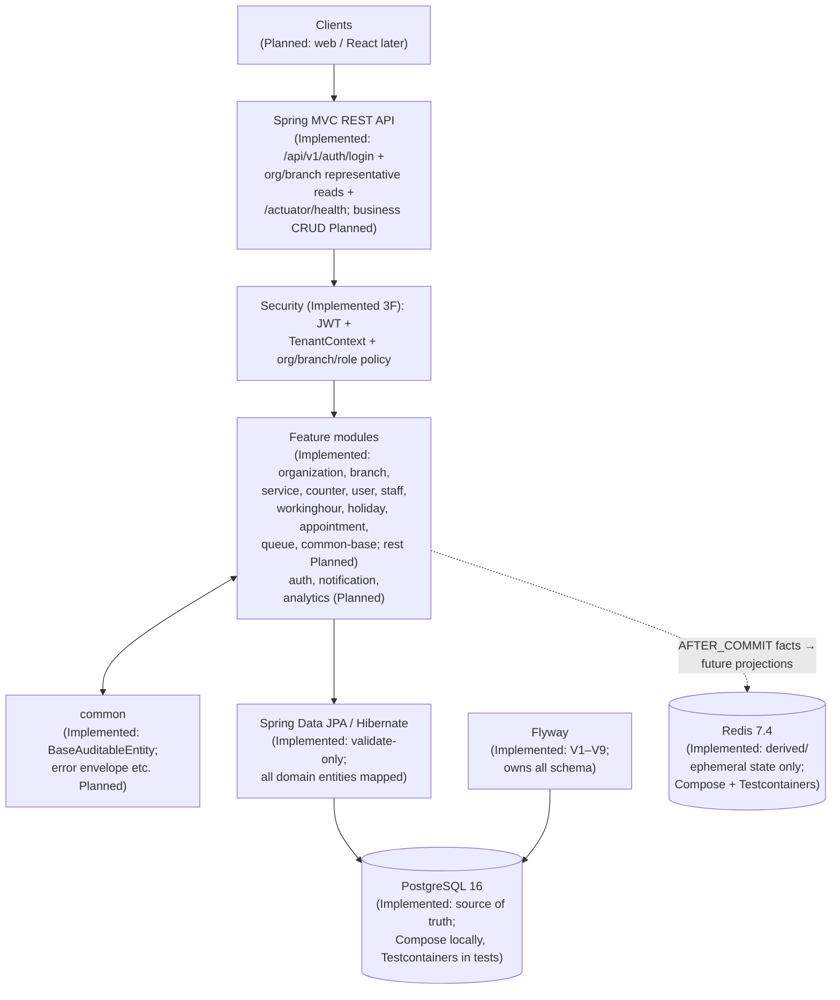

Why this shape: correctness and tenant isolation are easier to reason about
in one codebase with real ACID transactions (appointment double-booking
prevention, atomic queue claim); deployment stays simple; modules can be
extracted later if ever justified.

## 2. Intended Module Layout (`Planned`)

```text
com.sourabh.smartqueue
├── common          // Implemented: BaseAuditableEntity (UUID + timestamps)
├── organization    // Implemented: Organization, OrganizationStatus, repository
├── branch          // Implemented: Branch, BranchStatus, repository
├── service         // Implemented (2B): Service, ServiceStatus, repository
├── counter         // Implemented (2B): ServiceCounter, CounterCapability, repos
├── user            // Implemented (2C): User, RoleType grants, repository
├── staff           // Implemented (2C): StaffAssignment, repository
├── workinghour     // Implemented (2D): WorkingHour intervals, repository
├── holiday         // Implemented (2D): Holiday closures, repository
├── appointment     // Implemented (2E): entity, booking service, no REST yet
│                   //   + reminder/ (4F): UPCOMING sweep → durable claim →
│                   //   APPOINTMENT_REMINDER notification (thin scheduler)
├── analytics       // Implemented (4G): read-only overview (DTOs + aggregate
│                   //   queries + manager/admin REST, V13 indexes)
├── queue           // Implemented (2F–2I, 3A, 3C, 3D, 3E, 3F): services, 9 events,
│                   //   realtime/ snapshot projection + STOMP + freshness tick
├── tenant          // Implemented (3E): TenantContext, holder, required-exception
├── auth            // Implemented (3F): credentials, JWT, login API, policies
├── infrastructure  // Implemented (3B/3C/3F): redis keys + JSON codec, STOMP config + auth
├── notification    // Implemented (4D/4E): rows + REST + realtime + retention sweep
└── analytics       // Planned
```

Rules (unchanged): each module owns its controllers, services, domain logic,
repositories, DTOs, and mappers — but `organization`/`branch`/`service`/
`counter`/`user`/`staff`/`workinghour`/`holiday` exist as persistence only;
`appointment`/`queue` add focused use cases (booking; join/call/lifecycle/
estimates; events published, queue events consumed by the real-time
projection) but no REST, external broker, or authentication yet, by the
  Phase 2A–2F + 3A–3D decisions in ADR-007/008/009/010/011/012/013/014/015/
  016/017/018/020. `infrastructure/` holds keys + JSON codec + STOMP wiring only;
no business rule lives there. Do not scaffold future
modules until their phase begins (AGENTS.md §22 — no speculative scaffolds).

## Branch → Services/Counters (Implemented — Phase 2B)

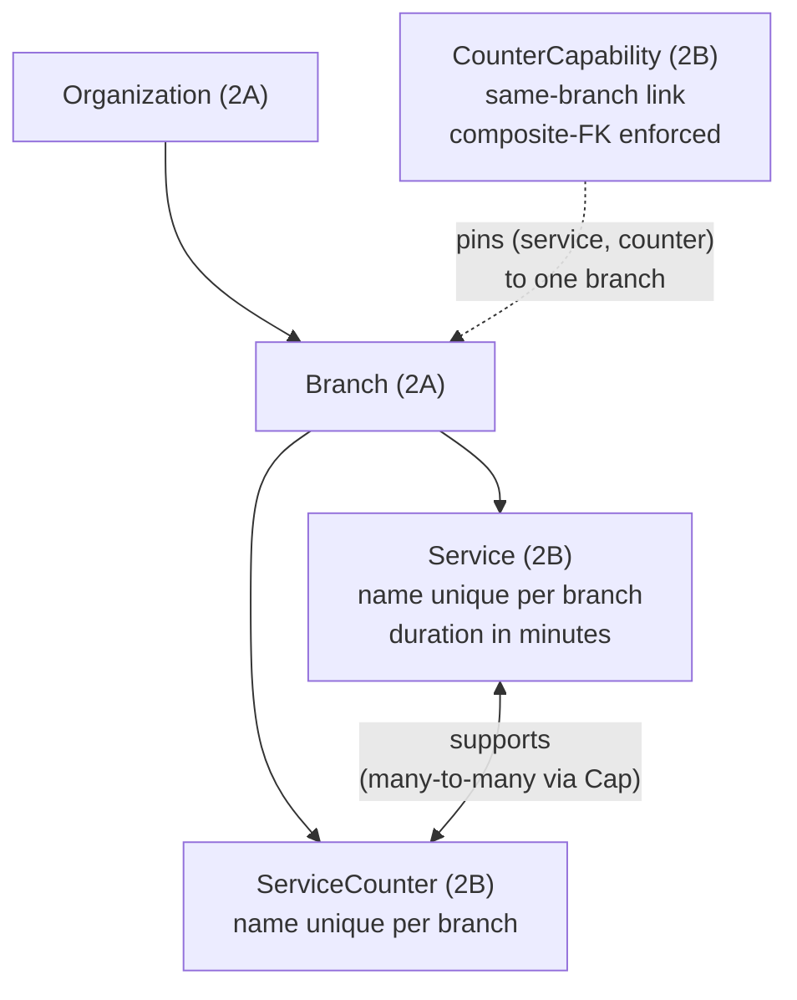

- A counter never belongs to a service; capability rows express support.
- Cross-branch links are impossible in the database (composite FKs), not
  just in code. JPA maps one join column per association (Hibernate rejects
  mixed writable/read-only composite columns); the migration owns the
  composites.

## Users, Roles & Staff (Implemented — Phase 2C)

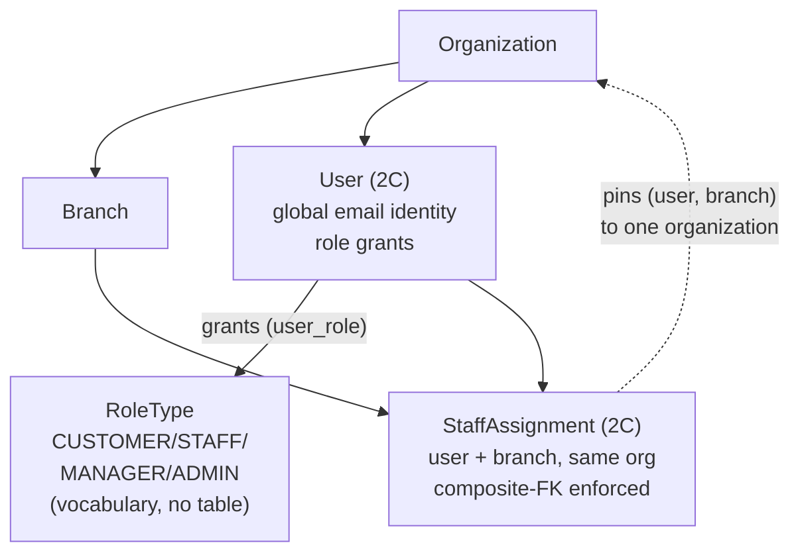

- A customer is a User with no assignment; staff hold one or more
  assignments; managers are organization-wide while staff need per-branch
  assignments — enforced by the authorization policy (Phase 3F). No runtime
  staff states either.

## Customer Identity & Organization Membership (Implemented — Phase 4R.3, ADR-040)

**Before (implemented per superseded ADR-036):** every user — customer
included — was owned by exactly one organization
(`app_user.organization_id NOT NULL`, V4). Customer registration required
an explicitly chosen ACTIVE `organizationId`; the JWT carried a required
`org` claim; `TenantContextFilter` installed the principal's organization
on every authenticated request; booking and queue joins were scoped
through `principal.organizationId()`; and the composite FKs
`(customer_id, organization_id)` on `appointment`/`queue_entry` (V6/V7)
pinned the customer to that organization in the database. One email = one
account in one organization (a documented ADR-036 limitation).

**Now (implemented in Phase 4R.3; V20 unpinned the schema in 4R.2).**
Customers are platform-level identities; organization-scoped operational
access is grounded in an explicit membership model.

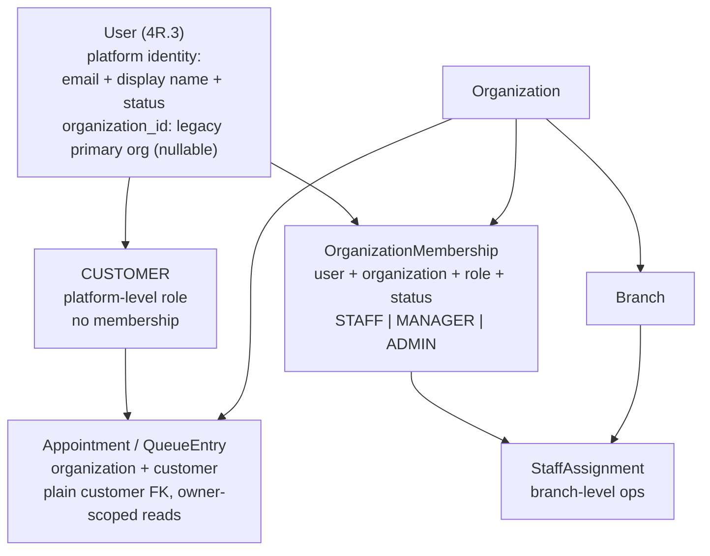

Implemented rules (ADR-040):

- **Customers hold no membership row — ever.** Registration is
  `{displayName, email, password}` with no organization; the account is
  created with `organization_id = NULL` and the CUSTOMER role. Selecting
  an organization to book or join a queue is request context, never
  membership. That is what makes one account serving many organizations
  correct by construction — one customer holds appointments and queue
  entries at Org A, B, C through one account.
- **`OrganizationMembership` (user, organization, role, status) is the
  sole authorization fact** for operational access: no row → no access.
  `UserManagementService` and invitation acceptance create/sync membership
  rows alongside role grants; V20 backfilled every pre-existing
  operational grant. `user_role` keeps the platform-level grants.
- **Two scopes, never collapsed.** Operational users receive a tenant
  context installed from the membership-resolved organization (the
  fail-closed `TenantContext`, unchanged in shape; background paths install
  explicit scope as before). Customers receive no global tenant context:
  every customer action resolves the owning organization from the target
  resource (`branchId`/`queueId`/`appointmentId` — validated ACTIVE), and
  reads are owner-scoped (`customer = principal`). A customer-supplied
  organization ID is never an authority for access. Engine services that
  consume the fail-closed holder (`QueueEntryLifecycleService`,
  `QueueWaitTimeEstimator`) are reached by customers only through an
  explicit, documented bridge that installs the context from the
  already-authorized row for the duration of one delegation — it can never
  widen access because authorization happened against that same row.
- **Principal/JWT (implemented):** the principal carries `userId`,
  `email`, `roles`, and a resolved `organizationId` that is `null` for
  customers; the JWT `org` claim is optional (present for operational
  users, absent for customers). Operational resolution prefers the legacy
  home organization when it has an ACTIVE membership, else the single
  active membership, else none (multi-membership selection is Planned).
- **Organization onboarding (implemented, Phase 4R.4, ADR-041):**
  business applications are created `PENDING_APPROVAL` with an
  `INACTIVE` owner membership; owner email verification proves inbox
  ownership only; a configured, verified `PLATFORM_ADMIN`
  (`app.platform.admin-emails` bootstrap, fail-closed) approves
  (`ACTIVE`, atomic with membership activation) or rejects
  (owner-visible reason, membership stays `INACTIVE`). Only `ACTIVE`
  organizations are discoverable/bookable — enforced in discovery, the
  booking/join domain backstops, and operational scope resolution, not
  just hidden in UI. Transitions are explicit; repeats and concurrent
  decisions answer `409` without forking state.
- **Invitations stay operational:** admins invite MANAGER/STAFF only
  (pre-existing); acceptance creates the membership row atomically;
  customers self-register. Organization ADMIN never becomes platform-wide.

See ADR-036 (historical, superseded) and ADR-040 (governing decision) for
the full rationale, alternatives, and recorded security invariants.

## Operating Calendar (Implemented — Phase 2D)

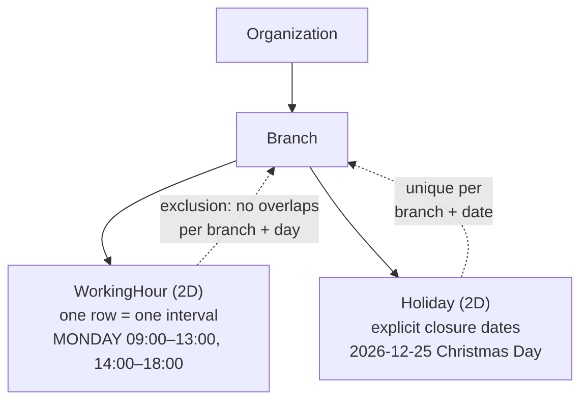

- A weekday with no rows means normally closed — no flags, no CLOSED rows.
- Range validity (guard + CHECK) and overlap-freedom (exclusion) hold in
  the database on every path; adjacency is allowed by `[start, end)`
  semantics. Minute-granular wall-clock times; timezone interpretation
  deferred to appointments. No availability computation exists yet.

## Appointment Booking (Implemented — Phase 2E)

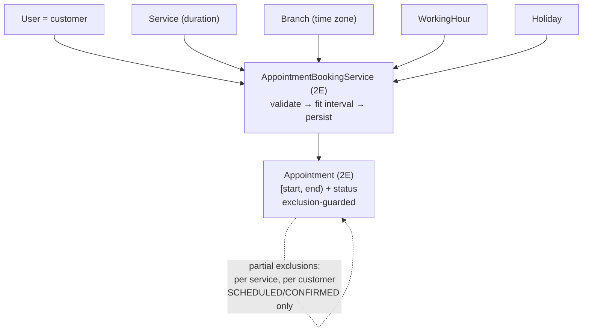

- First application logic in the codebase: one transactional booking method.
  Pre-checks give clear errors; the partial exclusions arbitrate races
  (proven: two-thread race → exactly one booking).
- Capacity assumption: one appointment per service per interval; no customer
  in two places at once. Terminal statuses free their slots. No REST, no
  availability listing, no rescheduling — those are later phases.

## Walk-In Queue (Implemented — Phase 2F)

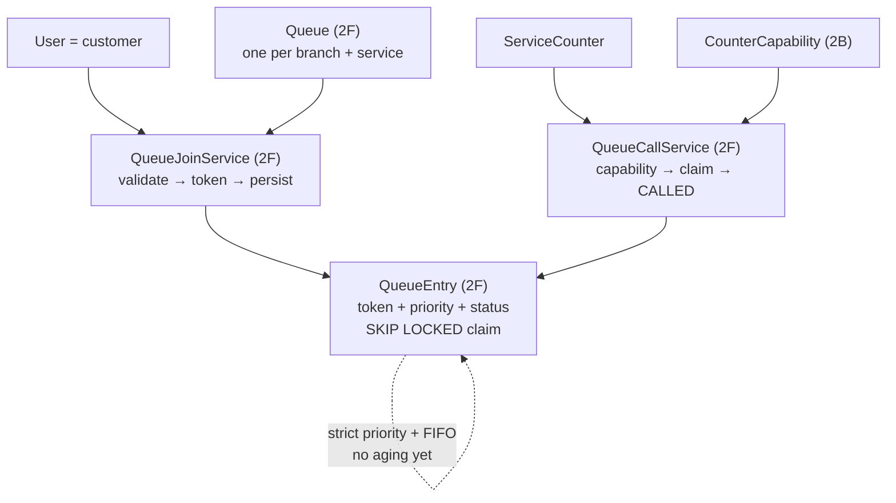

- One logical queue per branch+service, shared by all capable counters;
  tokens are per (queue, branch-date) integers from a locked counter row
  (never MAX+1). Claims are one ordered `FOR UPDATE SKIP LOCKED` query
  across every servable queue — concurrent callers never share a row
  (proven: 2- and 3-counter races claim exact entry sets). Strict priority
  with documented starvation trade-off; lifecycle WAITING→CALLED→SERVING→
  COMPLETED plus cancel/no-show exits. No events, no wait-time, no aging.

## Service Sessions (Implemented — Phase 2G)

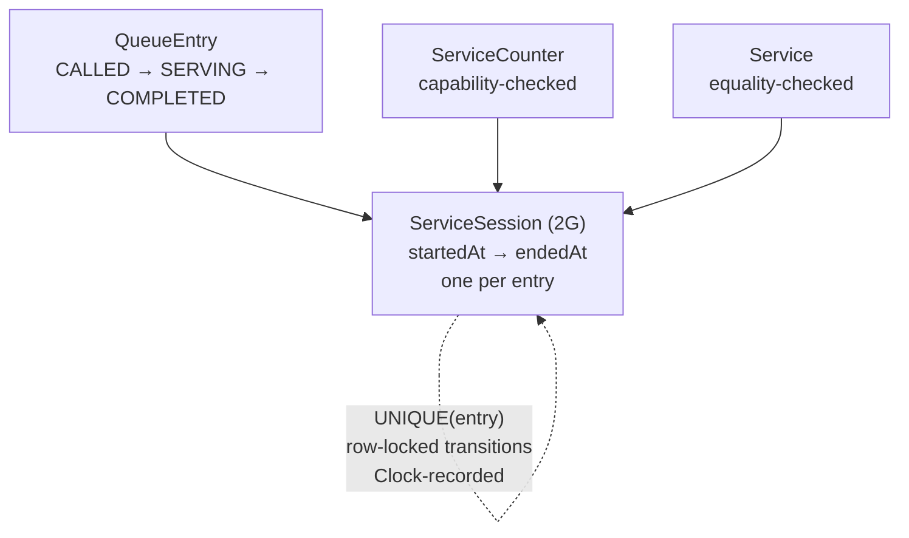

- Entry lifecycle and session writes commit atomically; concurrent starts
  (or completions) serialize on the entry row lock — exactly one session,
  exactly one end (proven by race tests). No status enum, no duration
  column, no counter runtime states; measured facts banked for later
  wait-time math, none computed.

## Queue Aging (Implemented — Phase 2H)

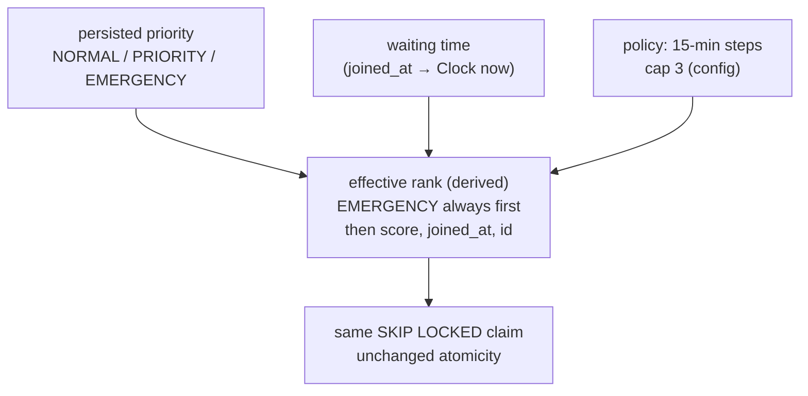

- Score = base weight (PRIORITY&nbsp;=&nbsp;1) + capped aging steps, computed
  in the claim SQL from epoch seconds — selection stays one atomic
  statement. EMERGENCY ceiling is structural; persisted priority never
  mutates; disabled mode reproduces the exact Phase 2F order. Guarantee:
  aged entries precede newer/lower competition; only continuous EMERGENCY
  arrivals can still starve. No migration (nothing stored), no new index
  (waiting-entry index still drives access).

## Wait-Time Estimation (Implemented — Phase 2I)

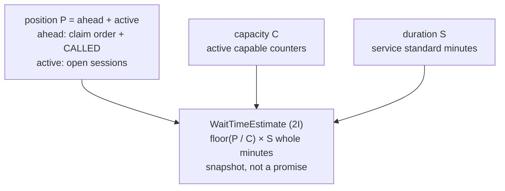

- Same ORDER BY text as claiming (shared fragment) → "ahead" means
  "would be claimed first", proven by estimate-order == claim-sequence
  test. Zero capacity / terminal entries / inactive queue → no estimate
  (never silent zero except CALLED/SERVING, which are effectively now).
  No ML, no history, no stored column, no migration.

## Domain Events (Implemented — Phase 3A)

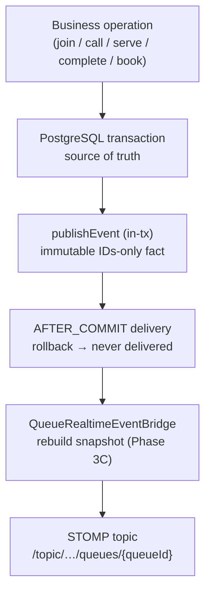

- Services publish facts (9 records in `queue/event/`,
  `appointment/event/`); consumers are the test collector proving
  commit/rollback semantics and the Phase 3C `QueueRealtimeEventBridge`.
  PostgreSQL remains the source of truth — this is not event sourcing. No
  outbox (no external/remote consumer to protect; the in-process bridge can
  always rebuild), no message broker, no async executors.

## Real-Time Queue State (Implemented — Phase 3C)

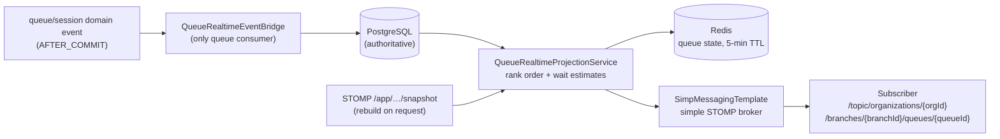

- **Rebuild, never increment.** Every committed queue/session event re-reads
  PostgreSQL and replaces the Redis snapshot, so a missed or reordered event
  cannot corrupt state (idempotent by construction). Ordering comes from the
  single shared `QueueRankingSql` fragment; waits from
  `QueueWaitTimeEstimator`.
- **Payload is public.** `QueueRealtimeState` exposes tokens, priority,
  status, wait minutes and generation time only — never customer UUIDs,
  emails, roles, or staff identity. Tenant ids ride along for correlation.
- **Degradation.** The bridge catches failures from Redis and from broker
  publishing and only logs them; the committed PostgreSQL transaction is
  never failed by real-time infrastructure. Snapshots expire via TTL, and
  the next event or client snapshot request rebuilds them.
- **Consistency limits (documented, not hidden):** snapshots are eventual,
  per queue, single-node (simple broker), last-write-wins across
  concurrent refreshes, and carry no monotonic sequence — a client that
  joins late may briefly see an older `generatedAt`.
- **Security.** Socket-connect and destination authorization arrived with
  the security foundation (ADR-021): handshakes require a bearer token
  and subscriptions stay within scope. Operational principals are bound
  to their membership-resolved organization; platform-level customers
  (ADR-040, Phase 4R.3) may subscribe to any ACTIVE queue's token-only
  topic — the destination names the queue and the queue proves the
  scope, while payloads carry no identity.

## Multi-Tenant Application Context (Implemented — Phase 3E)

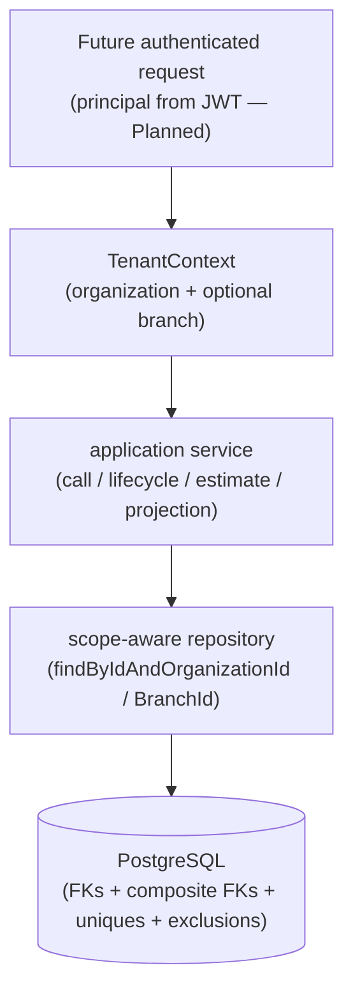

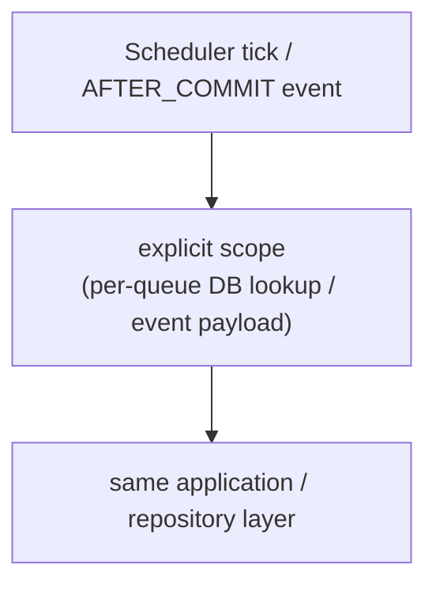

- **Two layers, both required.** The database prevents invalid
  relationships (composite FKs); the application context prevents
  accidental cross-scope reads and writes. Out-of-scope ids yield empty
  (scope-safe not-found) — callers cannot distinguish "missing" from
  "forbidden". Missing context fails closed (`TenantContextRequiredException`),
  never "all tenants".
- **Context ≠ authentication ≠ authorization ≠ role.** The record carries
  only the two scope ids; future security combines principal + context +
  policy without touching the domain (entities stay context-free, no
  Hibernate filters, shared database with logical isolation).
- **Background discipline.** The scheduler and event bridge never depend on
  a pre-set thread-local: each installs its own scope and *restores* (not
  clears) the previous one, so nested dispatch cannot destroy its caller's
  scope; worker threads install their own scope explicitly. Empty/inactive
  queues, Redis namespacing, and the unauthenticated-but-path-validated
  WebSocket contract are unchanged.
- **Planned split now implemented (ADR-040, Phase 4R.3):** this context
  remains the *operational* scope (organization resolved from an ACTIVE
  membership for STAFF/MANAGER/ADMIN). Customers receive no global tenant
  context — their actions derive organization from the target resource
  and read owner-scoped rows; engine paths that consume the fail-closed
  holder are reached only through an explicit per-request bridge that
  installs the already-authorized row's organization. The record, the
  fail-closed holder, and the scope-aware repositories are unchanged;
  only who installs the context changed.

## Live Wait-Time Refresh (Implemented — Phase 3D)

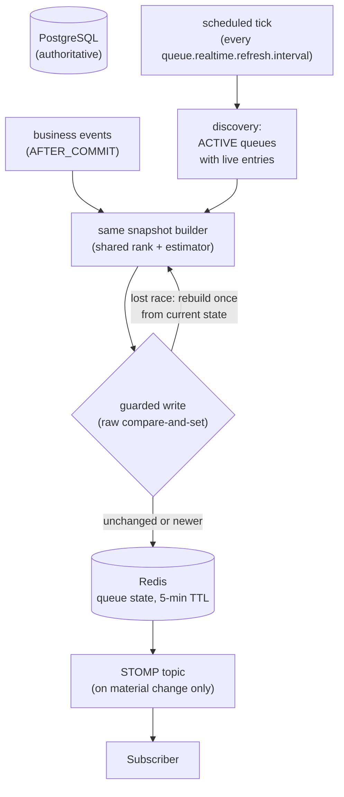

- **Two paths, one builder.** Event-driven refresh (Phase 3C, unchanged)
  and the scheduled tick both call `buildSnapshot` — the shared rank query
  plus the shared estimator — so a client cannot distinguish them and the
  two can never disagree on method, only on recency. Persisted priority is
  never mutated; aging stays derived.
- **Bounded drift, not "real-time".** Every queue holding live entries
  (`ACTIVE` + at least one `WAITING`/`CALLED`/`SERVING` row) is rebuilt at
  least once per interval (default one minute, `PT1M`). Empty and inactive
  queues are excluded by the discovery query; their keys expire untouched.
- **Quiet when unchanged.** Rebuilds compare live content ignoring
  `generatedAt` (which always moves). Unchanged content renews the Redis
  TTL silently; only material changes (reorder, wait movement, membership)
  publish to the topic.
- **Stale writes are structurally blocked.** The tick reads the raw Redis
  value before rebuilding and writes through an atomic Lua
  compare-and-set; a concurrent event refresh in between fails the guard,
  the stale snapshot is discarded, and one fresh rebuild is stored
  instead. Raw-JSON comparison, not timestamps (equal instants can carry
  different content).
- **Best-effort, downstream-only.** The scheduler mutates no business
  state; Redis/broker/PostgreSQL failures log and skip per queue. Two
  instances may duplicate the work (documented, accepted — no distributed
  lock for a derived-state refresh).

## Authentication & Authorization Foundation (Implemented — Phase 3F)

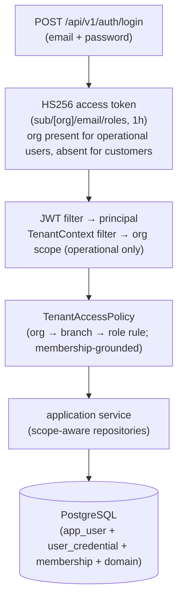

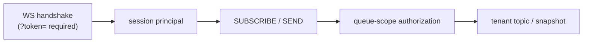

- **Three concepts, never collapsed.** Authentication (who — BCrypt
  credentials in a separate table, generic failures, inactive accounts
  rejected), tenant context (where — the membership-resolved organization
  bound at the HTTP boundary with save/restore, for operational users
  only; customers get no global context and derive scope per action from
  the target resource), authorization (what — ACTIVE-membership org
  match, branch ownership, then manager/admin-wide, staff-by-assignment,
  customer owner-scope). Roles stay the canonical `RoleType`; authorities
  are in-memory only; entities take no security dependencies.
- **Sockets are no longer open.** The handshake requires a bearer token
  (query parameter — browsers cannot set handshake headers) and binds the
  principal to the session, because STOMP CONNECT headers provably never
  reach it; SUBSCRIBE/SEND must stay within organization/branch/queue
  scope, and denial terminates the session. The snapshot controller
  re-checks path organization outside its log-only block.
- **Background stays unauthenticated by design.** Scheduler, event bridge,
  and projections install explicit scope from database/event state —
  never a fabricated JWT, never a thread-local they were not given.

## REST API & Contract Foundation (Implemented — Phase 3G)

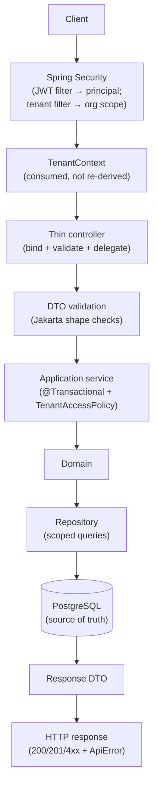

- **Two reads prove the pattern:** `GET /api/v1/organizations/{id}`
  (own org; anything else is scope-safe `404`) and
  `GET /api/v1/branches/{id}` (same-org scope first → `404` for foreign,
  then the Phase 3F branch role rule → `403`). No other CRUD — future
  phases extend this shape, never reinvent it.
- **One error envelope** (`ApiError`: timestamp/status/code/message/path/
  fieldErrors) from one `GlobalRestExceptionHandler`; domain exceptions
  translate to stable codes (`APPOINTMENT_CONFLICT`,
  `INVALID_QUEUE_STATE`, …). Validation failures carry per-field detail.
- **One OpenAPI document** (`/v3/api-docs`, UI at `/swagger-ui/index.html`)
  with the `bearerAuth` JWT scheme: public endpoints render unlocked,
  protected reads carry the requirement. Actuator stays outside the
  document and outside `/api/v1`.

## Branch Management API (Implemented — Phase 3H)

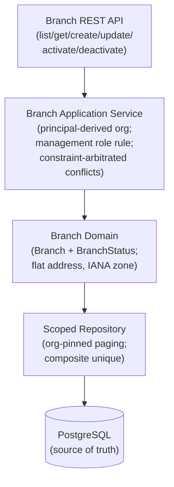

- **First management surface, template for the rest.** Reads keep the
  display rule; writes need `MANAGER`/`ADMIN` in the caller's own org
  (new `TenantAccessPolicy` management tier). Listing is the first
  paginated endpoint (`page`/`size`/`sort` allow-list + `id` tiebreak +
  `status` filter via reusable `common/api` parsing). Updates are PUT
  full-replacement (no PATCH); lifecycle moves through idempotent
  activate/deactivate commands (no DELETE — dependents never cascade).
  Name conflicts are constraint-arbitrated (`409`, no SQL leaks);
  cross-org duplicates stay legal. No migration, no new dependencies.

## Service, Counter & Capability API (Implemented — Phase 3I)

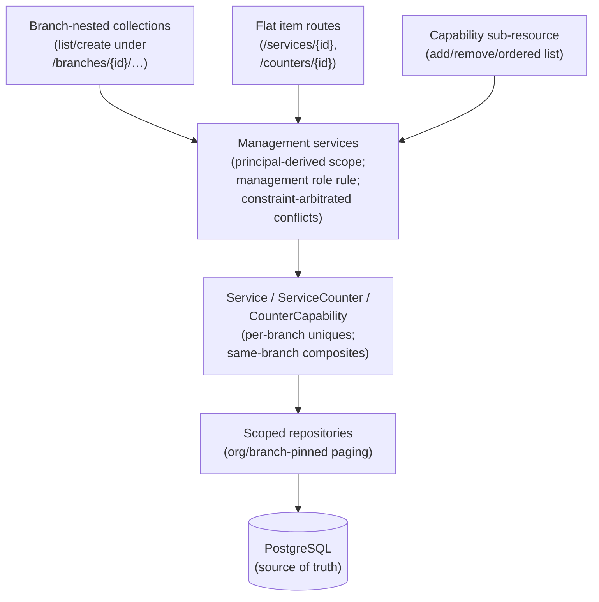

- **Branch template reused, association added.** Display reads,
  MANAGER/ADMIN org-scoped writes, paginated allow-list listing
  (services add `durationMinutes`), PUT replacement, idempotent
  commands, no DELETE — via the existing policy methods, no new ones.
  Capabilities ride the existing `CounterCapability` model (composite
  FKs untouched): ordered plain-array list, `201` add, `204` remove
  (missing → `404`); same-branch enforced in code (`422`) with the
  database as backstop. No migration, no new dependencies.

## User & Staff Management API (Implemented — Phase 3J)

```mermaid
flowchart TB
    Dir["User directory<br/>(list/get/create/update/<br/>activate/deactivate)"]
    Rost["Rosters<br/>(per-user + per-branch<br/>paginated lists)"]
    Link["Assignment links<br/>(create + activate/<br/>deactivate commands)"]
    Svc2["Management services<br/>(principal-derived org;<br/>tiered visibility;<br/>constraint-arbitrated conflicts)"]
    Dom2["User + StaffAssignment<br/>(global email unique;<br/>same-org composites)"]
    Auth["AuthService +<br/>credential service<br/>(unchanged 3F rules)"]

    Dir --> Svc2
    Rost --> Svc2
    Link --> Svc2
    Svc2 --> Dom2 --> PG2[("PostgreSQL<br/>(source of truth)")]
    Svc2 -.->|"provision hash;<br/>login honors status"| Auth
```

- **Sensitive directory, tiered visibility.** User list/records are
  management data (no customer/staff enumeration of org emails); branch
  rosters add operational visibility (assigned staff included, customers
  excluded); own record/assignments allow self-or-manager reads — two new
  policy methods, no controller checks. Email is immutable identity
  (global unique, `409`); roles replace wholesale, always org-scoped
  (no platform admin); optional creation-time password is BCrypt-hashed
  immediately, never returned; deactivation preserves history and fails
  login generically (proven through real HTTP login). Assignments require
  the STAFF role; the status-blind unique makes reactivation (not a second
  row) the path back; deactivation revokes branch access at once. No
  migration, no new dependencies.

## Appointment Booking API (Implemented — Phase 3K)

```mermaid
flowchart TB
    Book["POST branches/{id}/appointments<br/>(self-service booking)"]
    List["GET /appointments<br/>(role-routed list +<br/>overlap window)"]
    Cmd["cancel / complete /<br/>no-show commands"]
    Shell["REST application service<br/>(scope + privacy +<br/>future-start only)"]
    Eng["AppointmentBookingService<br/>(calendar, DST, snapshot,<br/>exclusion arbitration)"]
    DomA["Appointment<br/>(guarded transitions)"]
    PG3[("PostgreSQL<br/>(source of truth)")]

    Book --> Shell
    List --> Shell
    Cmd --> Shell
    Shell --> Eng --> DomA --> PG3
    Cmd --> DomA
```

- **Delegation, not duplication.** The REST shell owns shape, scope,
  self-customership, and the future-start rule; the 2E engine owns
  calendar/DST/snapshot/overlap untouched (race test still green).
  Privacy-first reads (owner/operational, else scope-safe 404); listing
  pins customers to self, staff to assigned branches, managers org-wide
  with scope-checked facets and an overlap window; lifecycle calls the
  guarded transitions with honest `409`s (no idempotent fiction, no
   status-write endpoint, no confirm flow). One conjunctive search query
   (flag-bound nullable instants — PG cannot type bare null binds). No
   migration, no new dependencies.

## Queue Management API (Implemented — Phase 3L)

```mermaid
flowchart TB
    Join["join / list /<br/>snapshot / entries"]
    Claim["counter call-next"]
    CmdQ["start / complete /<br/>cancel / no-show"]
    Adapt["REST adapter service<br/>(scope + privacy +<br/>explicit claim context)"]
    EngQ["Join / Call / Lifecycle /<br/>Estimator services<br/>(untouched engine)"]
    PG4[("PostgreSQL<br/>(source of truth)")]
    Ev["events → bridge →<br/>Redis + STOMP<br/>(unchanged flow)"]

    Join --> Adapt
    Claim --> Adapt
    CmdQ --> Adapt
    Adapt --> EngQ --> PG4
    EngQ --> Ev
```

- **Adapter, never a second engine.** Scope, authorization tiers, and
  view composition live in the adapter; ranking, aging, SKIP LOCKED
  claims, sessions, and waits stay in the engine untouched. Positions
  and waits reuse the shared rank query and estimator (what customers
  see is what `callNext` serves); realtime stays anonymous while REST
  carries identity for authorized eyes. Counter-centric claiming (the
  claim spans servable queues — a queue-scoped route would lie).
  Privacy-first reads, honest non-idempotent lifecycle, conjunctive
  record search. REST never reads Redis: a dedicated test proves
  join/state/claim succeed with Redis down. No migration, no new
  dependencies.

## Service Session Reads (Implemented — Phase 3M)

```mermaid
flowchart TB
    List["GET /service-sessions<br/>(facets, newest-first)"]
    Cur["counter current-session<br/>+ history"]
    Item["GET session<br/>(privacy-first)"]
    Read["read-only adapter<br/>(no transitions)"]
    Rows["ServiceSession rows<br/>(written by 3L only)"]
    PG5[("PostgreSQL<br/>(source of truth)")]

    List --> Read
    Cur --> Read
    Item --> Read
    Read --> Rows --> PG5
```

- **Read-only by design.** No lifecycle commands exist here (3L owns
  them); the adapter never transitions anything. Operational visibility
  (managers/admins, assigned staff; customers have no session views),
  privacy-first item reads, newest-first history, conjunctive facets
  with the 3K presence-flag pattern for the startedAt window. "Current"
  reuses the domain's running definition (`endedAt IS NULL`, newest
  wins); idle 404 doubles as the derived occupancy signal. No ADR —
  pure template application. No migration, no new dependencies.

## 3. Layering Within a Module (`Planned` — enforced from first domain code)

```mermaid
flowchart TD
    C["Controller<br/>(thin: HTTP, validation, auth wiring)"]
    S["Application / Service layer<br/>(@Transactional boundaries)"]
    D["Domain / business logic<br/>(pure rules, state transitions)"]
    R["Repository / data access<br/>(Spring Data JPA)"]

    C --> S --> D --> R
```

- Business logic MUST NOT live in controllers.
- Never expose JPA entities via REST — immutable `record` DTOs + explicit
  mapping.

## 4. Request Flow (`Planned`)

```mermaid
sequenceDiagram
    participant C as Client
    participant Ctrl as Controller
    participant Sec as Security<br/>(JWT + role + resource checks)
    participant Svc as Service<br/>(@Transactional)
    participant DB as PostgreSQL

    C->>Ctrl: HTTP request + JWT
    Ctrl->>Sec: authenticate + authorize<br/>(role AND org/branch/resource)
    Sec-->>Ctrl: principal (deny by default)
    Ctrl->>Svc: DTO (validated)
    Svc->>DB: scoped queries + locking/constraints
    DB-->>Svc: committed state
    Svc-->>Ctrl: response DTO
    Ctrl-->>C: response envelope
```

Tenant isolation is enforced at the service layer (scoped queries +
ownership checks), never by trusting client-supplied IDs.

## 5. Multi-Tenancy (`Planned`)

```mermaid
flowchart TD
    Org["Organization"]
    Br["Branch"]
    Res["Services / Counters / Staff /<br/>Appointments / Queues"]

    Org --> Br --> Res
```

- Shared PostgreSQL database, logical tenancy (ADR-019 to be written when
  modelling starts).
- Every organization-owned resource traces back to exactly one organization.

## 6. Concurrency Strategy (Partially Implemented — Phases 2E + 2F)

- Appointments (Implemented): one `@Transactional` booking method +
  partial exclusion constraints (per service, per customer,
  SCHEDULED/CONFIRMED only) prevent double-booking — concurrent inserts
  serialize on the exclusion indexes and exactly one wins (proven by the
  two-thread race test). No `synchronized`, no isolation changes.
  Never `synchronized` anywhere.
- Queue claim (Implemented — Phase 2F): one ordered `FOR UPDATE SKIP
  LOCKED` claim across every queue a counter may serve; concurrent callers
  never share a row — the loser skips locked rows and takes the next
  eligible entry (proven by 2- and 3-counter races). Aging in the claim
  order (Implemented — Phase 2H); any future re-weighting stays Planned.
- Service sessions (Implemented — Phase 2G): entry row locked first;
  concurrent starts/completions serialize and exactly one wins (proven by
  race tests); `UNIQUE(queue_entry_id)` backstops. No `@Version` — the
  locks already order the only writers.
- PostgreSQL is the arbiter of truth under concurrency; Redis never is.

## 7. Redis Usage (Implemented — Phase 3B, consumed in 3C)

Redis 7.4 (`smartqueue-redis` locally, Testcontainers in tests) holds
derived/ephemeral snapshots only: queue-state snapshots (Phase 3C live),
wait-time estimates, short-lived availability, rate limiting — all
rebuildable from PostgreSQL, all with explicit TTLs. Every cached value
needs an expiry/invalidation story. On doubt, read PostgreSQL. Conventions
live in `infrastructure/redis/` (tenant-scoped keys, JSON codec). No cluster/sentinel, no volume
(disposable by design), no password locally (deferred production concern).

## 8. Notifications (Implemented — Phase 4D, `IN_APP` only)

Business logic depends on a `NotificationSender` port; `IN_APP` first, email
later. No provider SDK calls inside appointment/queue services.

`notification/` owns the persisted model (`notification` table, V10),
the `NotificationService` boundary (persist-first in its own
transaction, best-effort realtime echo), the `NotificationEventListener`
(AFTER_COMMIT mapping of six customer-meaningful facts to rows), the
recipient-scoped REST surface, and the `InAppNotificationSender`
(user-destination echo over the existing STOMP broker). The session
principal names sessions by user id so `/user/queue/notifications`
resolves per session; the channel interceptor allows exactly that
destination. No staff broadcasts, no exactly-once
claims — see ADR-032 and `docs/api/notifications.md`.

Notification creation and notification retention are independent
flows that share only the table (Phase 4E, ADR-033):

```text
creation:  business tx → commit → AFTER_COMMIT → REQUIRES_NEW persist → best-effort echo
retention: scheduled tick → Clock cutoffs → batched id bulk deletes (own tx per batch)
```

The retention sweep (`NotificationRetentionService`, every
`notifications.retention.interval`, default PT6H) deletes read rows
older than `read-after` (default P90D) and unread rows older than
`unread-after` (default P365D), both anchored on `created_at`. It
loads no entities, emits no events, needs no tenant data, and never
joins user or creation transactions; failures log and retry next
tick; concurrent instances are safe without coordination. V11 adds
`idx_notification_created_at` because both V10 indexes lead with
`recipient_user_id` and cannot serve the global timestamp sweep.

## 8b. Appointment Reminders (Implemented — Phase 4F)

```text
Appointment
    ↓
Reminder scheduler (every appointment.reminders.interval, default PT10M)
    ↓
Reminder idempotency (appointment_reminder, V12)
    ↓
Notification persistence (APPOINTMENT_REMINDER, customer-only)
    ↓
Existing realtime delivery (best-effort echo)
```

Reminder scheduling is independent from ordinary appointment booking:
booking commits facts; a separate fixed-delay sweep discovers active
appointments starting within the lead window (`startAt − before`,
default PT24H, compared as instants — DST cannot shift the due
moment), claims each in its own transaction together with its
notification row, and renders copy in the branch timezone. The
`uq_appointment_reminder (appointment_id, reminder_type)` constraint
arbitrates concurrent schedulers (at-least-once ticks, at-most-once
rows, no exactly-once claim); cancelled/completed/no-show rows are
excluded by re-checking status inside each candidate transaction.
V12 also adds `idx_appointment_status_start (status, start_at)` for
the bounded discovery window. No REST, no settings UI, no external
channels — see ADR-034 and `docs/api/notifications.md`.

## 8c. Operational Analytics (Implemented — Phase 4G)

```text
authenticated manager/admin
        ↓
analytics REST API (one overview endpoint)
        ↓
read-only aggregation queries (COUNT/SUM/AVG, shared scope)
        ↓
PostgreSQL (authoritative — no second store, no cache)
```

Analytics is a read-only lens, never a second source of truth: one
explicit `[from, to)` window and scope feed every aggregate, so
summary and breakdowns cannot disagree. Appointments anchor on
`startAt`, entries on `joinedAt`, sessions on `startedAt`; waits and
durations derive from stored timestamps only (never live
estimates); empty data yields `0` counts and `null` averages.
Tenant scope comes from the principal; V13 adds three
predicate-shaped reporting indexes. No warehouse, no cache, no
brokers — see ADR-035 and `docs/api/analytics.md`.

## 9. Infrastructure Slice (Implemented — Phase 1)

```text
Application (Spring Boot 4.1.1, Java 21)
    ↓  HikariCP datasource (DB_* env vars, defaults → Compose DB)
Spring Data JPA (ddl-auto: validate, open-in-view: false;
Org, Branch, Service, Counter, Capability, User, Assignment mapped)
    ↓
PostgreSQL 16 (Compose `smartqueue-postgres` locally with named volume +
healthcheck; Testcontainers `postgres:16-alpine` in tests)
    ↑
Flyway 12 (V1–V8 applied on startup; owns all schema)
```

- Domain slices proven (2A–2G): org/branch (V2), services/counters/
  capabilities (V3), users/roles/staff (V4), calendar (V5), appointments
  (V6: branch zones, snapshotted `[start, end)`, partial exclusions),
  queue (V7: one queue per branch+service, daily tokens, strict priority,
  SKIP LOCKED claims, guarded lifecycle), sessions (V8: one per entry,
  row-locked atomic start/completion, Clock-recorded); UUID ids,
  `Instant` audits, string enums, scoped uniqueness.
- Runtime proven: app boots against Compose PostgreSQL, Flyway validates
  8 migrations (schema v8), Hibernate validate passes, `/actuator/health`
  reports UP.
- Tests proven: 263 tests, 0 failures — 30 tenant isolation (11 context
  lifecycle + 16 cross-org/cross-branch denial + 3 background without HTTP
  context) + 24 scheduled-freshness (14 refresh
  incl. threshold/cap/emergency/zero-capacity/multi-counter/called-serving/
  terminal/discovery/event-interaction/stale/broker-failure + 3 live-tick
  wiring + 2 disabled + 5 config validation) + 16 real-time (10 projection
  incl. rebuild/idempotency/TTL/privacy + 4 live-STOMP incl. isolation + 2
  Redis-outage degradation) + 7 Redis
  + 9 events + 17 estimation + 11 aging + 19 sessions + 33 queue +
  33 appointment + 18 calendar + 16 user/staff + 15 service/counter +
  10 org/branch + 4 infra + `contextLoads`.
- Test lesson recorded (Phase 2A): one Testcontainers container per test
  class — a shared static container's stop/start lifecycle races between
  subclasses.
- Mapping lesson recorded (Phase 2B): Hibernate rejects mixed
  writable/read-only columns in one `@JoinColumns` — composites live in
  Flyway, JPA maps simple joins; and Hibernate maps `Duration` to opaque
  numeric (rejects `INTERVAL`), hence explicit minutes columns.
- Decisions: ADR-003 (PostgreSQL), ADR-004 (Flyway), ADR-005
  (Testcontainers), ADR-006 (UUID + timestamps), ADR-007 (ownership;
  no services/APIs in 2A), ADR-008 (capability model; no services/APIs
  in 2B), ADR-009 (users/roles/staff; no passwords/Security in 2C),
  ADR-010 (calendar; exclusion-guarded intervals, no availability yet),
  ADR-011 (booking; partial exclusions, race-proof, no REST yet),
  ADR-012 (queue; tokens, SKIP LOCKED claims, no events/wait-time yet),
  ADR-013 (sessions; measured facts, row-locked atomicity, no estimates),
  ADR-014 (aging; derived rank, EMERGENCY ceiling, capped, no migration),
  ADR-015 (estimation; position model, shared ordering, whole minutes),
  ADR-016 (events; immutable facts, AFTER_COMMIT, no brokers/consumers),
  ADR-017 (Redis; derived-only, keys/TTL/health, degradable),
  ADR-018 (real-time; snapshots, STOMP, auth in 3F),
  ADR-020 (live refresh; bounded drift, guarded writes, no locks).
  ADR-019 (tenant context; org+branch scope, fail-closed holder,
  scope-aware repositories, explicit background scope).
   ADR-021 (auth foundation; BCrypt, JWT, login API, tenant-bound security,
   org/branch/role policy, authenticated sockets).
   ADR-022 (REST contract; /api/v1, thin controllers, DTOs, ApiError
   envelope, scope-safe reads, OpenAPI with bearerAuth, pagination
   convention deferred to first list endpoint).
   ADR-023 (branch management; MANAGER/ADMIN writes, paginated
   allow-list sorting, PUT replacement, activate/deactivate commands,
   constraint-arbitrated conflicts, no migration).

## 10. What Exists Today (Actual)

- `SmartQueuePlatformApplication` — Boot entry point (still no business
  logic beyond persistence).
- `common/BaseAuditableEntity` — UUID id + `Instant` timestamps.
- `organization/` — `Organization`, `OrganizationStatus`, bare repository.
- `branch/` — `Branch`, `BranchStatus`, bare repository.
- `application.yml` — datasource/JPA/Flyway/Actuator/security-JWT (env-based).
- `service/api/` + `service/application/` — `ServiceResponse` DTO
  (duration minutes), create/update payloads, `ServiceManagementService`
  (scoped list/get/create/update/activate/deactivate), `ServiceController`
  (flat item routes) + `BranchServicesController` (nested list/create).
- `counter/api/` + `counter/application/` — `CounterResponse` DTO,
  create/update payloads, `CounterManagementService`,
  `CounterCapabilityService` (same-branch `422`, constraint-arbitrated
  `409`s, association-only removal), `CounterController` +
  `BranchCountersController` + `CounterCapabilityController`.
- `user/api/` + `user/application/` — `UserResponse` DTO (no
  credentials ever), create/update payloads (immutable email, wholesale
  roles, creation-time password only), `UserManagementService`
  (management directory + self-or-manager reads, constraint-arbitrated
  email conflicts), `UserController`.
- `staff/api/` + `staff/application/` — `AssignmentResponse`,
  `BranchStaffResponse` roster rows, `StaffAssignmentService`
  (operational rosters, STAFF-gated creation, reactivation path,
  access-coupled lifecycle), `UserAssignmentsController` +
  `BranchStaffController` + `StaffAssignmentController`.
- `workinghour/` — `WorkingHour` (immutable intervals), `DayOfWeekConverter`,
  bare repository.
- `holiday/` — `Holiday`, bare repository.
- `appointment/` — `Appointment`, `AppointmentStatus`, guarded transitions,
  `AppointmentBookingService` (2E engine, unchanged), `AppointmentService`
  (3K REST shell: self-booking, privacy reads, role-routed list,
  lifecycle translation), `AppointmentController` (flat list/item/
  commands) + `BranchAppointmentsController` (nested booking),
  conjunctive `search` (ADR-026).
- `queue/api/` + `queue/application/` — entry/queue/detail/session DTOs,
  join/read/command payloads, `QueueService` adapter plus the read-only
  `ServiceSessionService`, seven thin controllers (branch collections,
  queue state, entry items, counter-centric claim, session list/item,
  counter current/history).
- `queue/` also: `ServiceSession`, `ServiceSessionRepository`, project
  `Clock` (in `common`), `QueueAgingProperties` (`queue.aging.*` config) —
  measured interactions + derived aging, no estimates.
- `queue/` also: `WaitTimeEstimate`, `QueueWaitTimeEstimator`,
  `QueueWaitTimeQueries`, `QueueRankingSql` (shared order fragment).
- `queue/event/` + `appointment/event/` — 9 immutable fact records,
  published by join/call/lifecycle/booking services, AFTER_COMMIT delivery.
- `queue/realtime/` — state + views, projection service (build/store/
  guarded compare-and-set), event bridge, scheduled freshness service
  (`PT1M` tick, discovery of queues with live entries, quiet-on-unchanged),
  refresh properties, STOMP controller, destination convention.
- `tenant/` — `TenantContext` (org + optional branch, immutable),
  `TenantContextHolder` (fail-closed ThreadLocal with save/restore),
  `TenantContextRequiredException`.
- `auth/` — `UserCredential`, `AuthProperties`, `AuthenticatedPrincipal`,
  `JwtService`, `PasswordCredentialService`, `AuthService`,
  `AuthController` (login, OpenAPI-tagged) + shared error envelope,
  `SecurityConfig`, JWT + tenant filters, `TenantAccessPolicy`, STOMP
  handshake/channel auth.
- `common/api/` — `ApiError` envelope, scope-safe
  `ResourceNotFoundException`, `GlobalRestExceptionHandler` (validation,
  auth, domain-conflict, and fallback mappings; no secrets in bodies/logs)
  plus the pagination foundation (`ApiPageRequest`, `ApiPage`,
  `InvalidRequestException`).
- `organization/api/` + `organization/application/` — `OrganizationResponse`
  DTO (manual mapping), `OrganizationService` (own-org read), thin
  `OrganizationController`.
- `branch/api/` + `branch/application/` — `BranchResponse` DTO (flat
  address), create/update payloads, `BranchService` (scoped
  list/get/create/update/activate/deactivate with constraint-arbitrated
  conflicts), thin `BranchController` (paginated list, PUT replacement,
  status commands, `Location` on create).
- `user/api/` + `user/application/` — `UserResponse` DTO (no
  credentials ever), create/update payloads (immutable email, wholesale
  roles, creation-time password only), `UserManagementService`
  (management directory + self-or-manager reads, constraint-arbitrated
  email conflicts), `UserController`.
- `staff/api/` + `staff/application/` — `AssignmentResponse`,
  `BranchStaffResponse` roster rows, `StaffAssignmentService`
  (operational rosters, STAFF-gated creation, reactivation path,
  access-coupled lifecycle), `UserAssignmentsController` +
  `BranchStaffController` + `StaffAssignmentController`.
- `counter/api/` + `counter/application/` — `CounterResponse` DTO,
  create/update payloads, `CounterManagementService`,
  `CounterCapabilityService` (same-branch `422`, constraint-arbitrated
  `409`s, association-only removal), `CounterController` +
  `BranchCountersController` + `CounterCapabilityController`.
- `infrastructure/openapi/` — `OpenApiConfig` (document metadata +
  `bearerAuth` JWT scheme).
- `infrastructure/redis/` — `RedisKeyConvention` (tenant-scoped keys) +
  `RedisJson` (Jackson-3 JSON codec); auto-configured `StringRedisTemplate`.
- `infrastructure/websocket/` — STOMP config (`/ws`, simple broker, open
  origins by documented decision, authenticated handshake + scoped channel).
- `db/migration/`: V1–V9, all asserted applied by tests (V9 holds the
  credential table only).
- `compose.yaml` — local PostgreSQL + Redis (healthchecks); `.env.example`
  — placeholder env vars incl. `REDIS_HOST`/`REDIS_PORT`/`JWT_SECRET`.
- 452 passing tests (7 session black-box HTTP
  + 20 queue black-box HTTP + 1 Redis-down REST proof
  + 15 appointment black-box HTTP
  + 22 user/staff black-box HTTP + 2 policy units
  + 23 service/counter/capability black-box HTTP
  + 28 branch-management black-box HTTP + 3 policy units
  + 16 REST-foundation black-box HTTP + 52 security + 30 tenant isolation
  + 24 scheduled-freshness + 16 real-time + 7 Redis +
  9 events + 17 estimation + 11 aging + 19 sessions + 33 queue +
  33 appointment + 18 calendar + 16 user/staff + 15 service/counter +
  10 org/branch + 4 infra + `contextLoads`; Docker required).
- Branch + service/counter/capability + user/staff + appointment + queue
  + session management REST with DTOs, shared validation/error
  conventions, and OpenAPI; notifications, analytics, and availability
  search remain `Planned` as marked above.

## 11. Evolution Map

Phase 0/0.5 governance + Boot decision (done) → Phase 1 infrastructure
(done) → Phase 2A Organization/Branch (done) → Phase 2B Services +
Counters (done) → Phase 2C Users & Staff (done) →
Phase 2D Working Hours & Holidays (done) →
Phase 2E Appointments (done) →
Phase 2F Queue (done) →
Phase 2G Service Session (done) →
Phase 2H Queue Aging (done) →
Phase 2I Wait-Time Estimation (done) →
  Phase 3A Domain Events (done) →
  Phase 3B Redis (done) →
  **Phase 3C Real-Time (done)** →
  **Phase 3D Live Refresh (done)** →
  **Phase 3E Tenant Context (done)** →
  **Phase 3F Auth Foundation (done)** →
  **Phase 3G REST Foundation (done: /api/v1 conventions, DTOs, ApiError
  envelope, representative org/branch reads, OpenAPI)** →
  **Phase 3H Branch Management (done: scoped list/create/update/
  activate/deactivate, pagination, management-role matrix)** →
  **Phase 3I Service/Counter/Capability (done: nested
  collections + flat items, association API, 422 mismatch)** →
  **Phase 3J User/Staff (done: tiered directory visibility,
  org-scoped roles, creation-time passwords, login-coupled lifecycle)** →
  **Phase 3K Appointments (done: self-service booking,
  privacy-first reads, honest non-idempotent lifecycle, conjunctive
  search)** →
  **Phase 3L Queues (done: thin adapter, counter-centric claim,
  shared rank/estimator views, Redis-independent correctness)** →
  **Phase 3M Sessions (done, this doc: read-only adapter, operational
  visibility, newest-first history, derived occupancy)** →
  **Phase 3N Frontend foundation (done: React 18 + strict TS + Vite +
  Router shell, real login, role nav, CORS allow-list, ADR-028)** →
  **Phase 4A Customer experience (done: appointment book/list/detail/
  cancel, queue join + live status, realtime-as-signal, ADR-029)** →
  **Phase 4B Staff operations (done: branch dashboard, live queue ops,
  counter call-next/serve/complete, sessions, appointments, ADR-030)** →
  manager/admin screens, notifications (all NOT started) → later phases
  per `docs/PROJECT_STATUS.md` and AGENTS.md §26.
